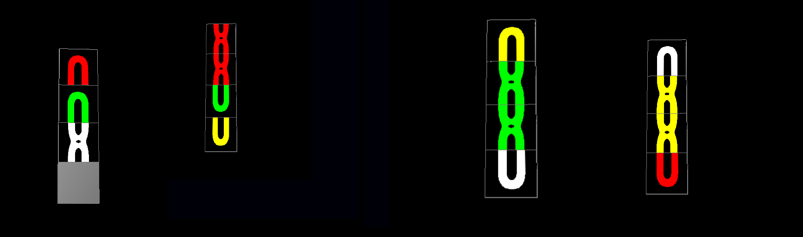

# Elo Maluco — Visão Computacional + Simulador 3D

Projeto da disciplina de **Processamento Digital de Imagens (UNIFEI)** que reconhece o estado
do quebra-cabeça **Elo Maluco** a partir de imagens e o reproduz em um simulador 3D interativo.

O projeto tem duas partes que se comunicam por um arquivo XML:

```
 fotos das 4 faces ──►  Reconhecimento (Python + OpenCV)  ──►  estado.xml  ──►  Simulador 3D (C++ + OpenGL)
```

## 🔍 1. Reconhecimento de estado — Python + OpenCV


*Entrada: as quatro faces do Elo Maluco.*

Para cada face, o pipeline:

1. **Detecta as bordas** do brinquedo (escala de cinza → suavização Gaussiana → Canny →
   maior contorno) e recorta a região de interesse
2. **Normaliza** o recorte para um tamanho padrão
3. **Classifica a cor** de cada uma das 4 peças da coluna usando faixas no espaço **HSV**
   (o vermelho usa dois intervalos, pois fica no início e no fim da escala de matiz)
4. **Identifica a textura** de cada peça — topo, meio, base ou vazio — analisando quais
   metades da peça têm cor
5. **Gera o XML** com a matriz 4×4 do estado atual

Exemplo de saída ([`exemplo_saida.xml`](reconhecimento/output/exemplo_saida.xml)):

```xml
<EloMaluco>
    <EstadoAtual>
        <row>
            <col>vmm</col>   <!-- vermelho, meio -->
            <col>vrm</col>   <!-- verde, meio -->
            <col>vzo</col>   <!-- vazio -->
            <col>ams</col>   <!-- amarelo, superior -->
        </row>
        ...
```

### Como executar

```bash
cd reconhecimento
python -m venv venv
source venv/bin/activate        # Windows: venv\Scripts\activate
pip install -r requirements.txt
python main.py                  # gera output/output.xml
```

## 🎮 2. Simulador 3D — C++ + OpenGL

Renderiza o Elo Maluco em 3D e permite:

- **Carregar um estado** a partir de um arquivo XML (inclusive o gerado pelo reconhecimento)
- **Jogar manualmente** a partir desse estado
- **Executar passo a passo** uma sequência de ações descrita no XML
- **Salvar o estado atual** do jogo em XML

As texturas das peças ([`img/`](simulador-3d/img)) e a leitura dos arquivos XML
([TinyXML-2](https://github.com/leethomason/tinyxml2)) são carregadas em tempo de execução.

### Como executar (Linux)

```bash
sudo apt-get install cmake build-essential libgl1-mesa-dev freeglut3-dev libxmu-dev libxi-dev libglm-dev
cd simulador-3d
mkdir build && cd build
cmake ..
make
./Elo_Maluco
```

## 🛠️ Tecnologias


## 📁 Estrutura

```
reconhecimento/   pipeline OpenCV (main.py), imagens de entrada (data/) e saídas (output/)
simulador-3d/     simulador em C++/OpenGL (src/), texturas (img/) e estados XML (data/)
docs/             imagens do README
```

## 👩‍💻 Equipe

- **Juliana Elen Silva Oliveira**
- Anaquerzia Alice do Couto
- Andrea Ayala
